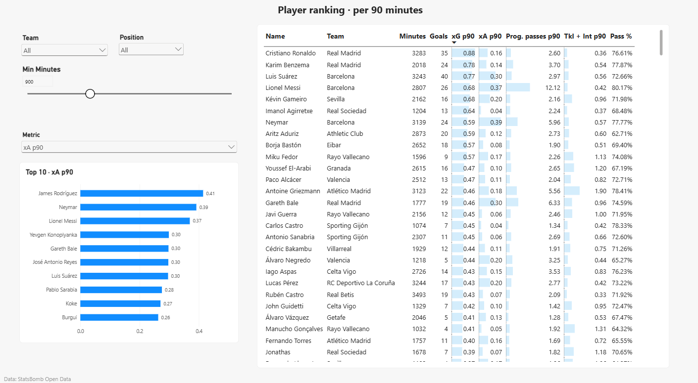
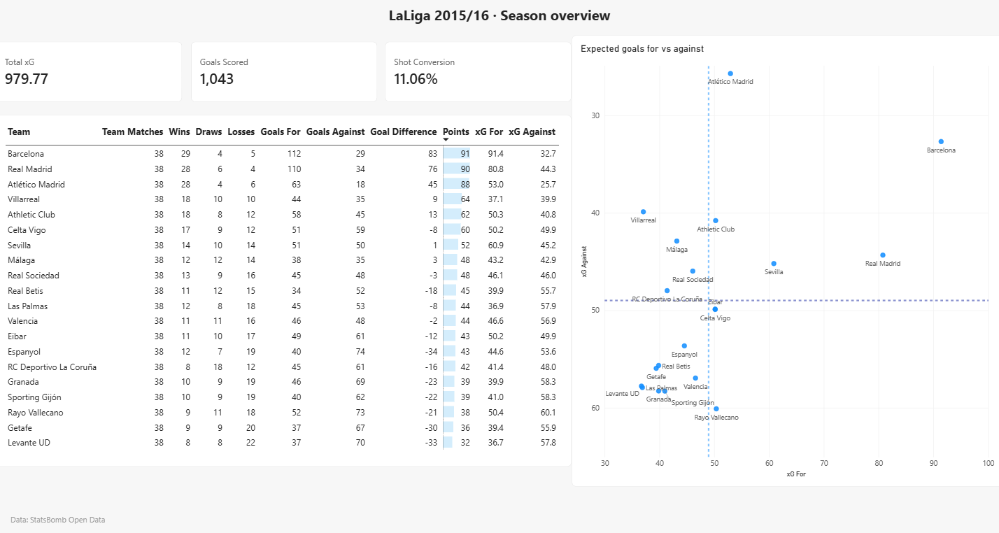
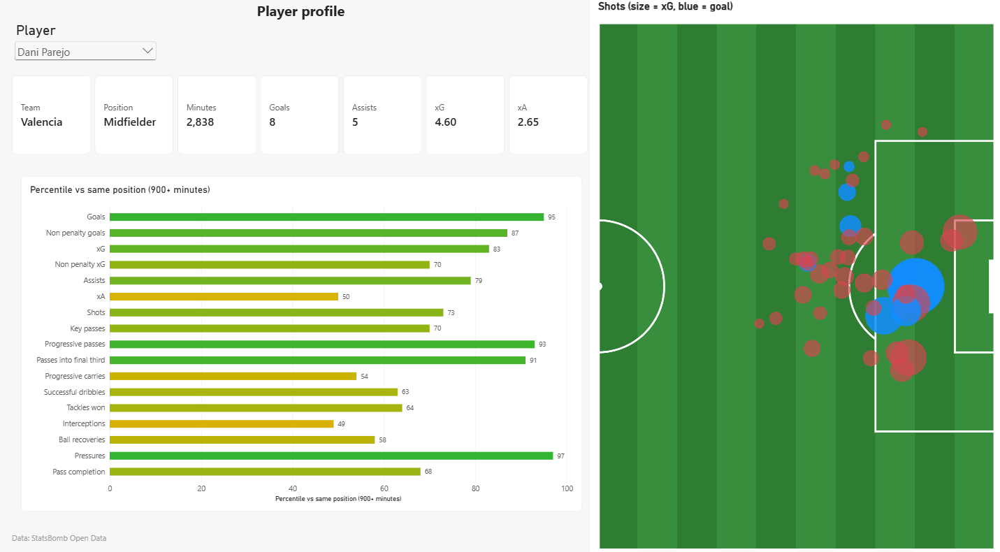
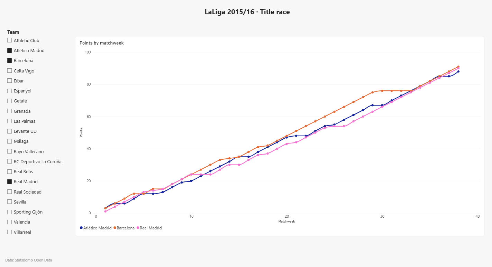

# LaLiga 2015/16 scouting dashboard (Power BI)

A four page Power BI dashboard built on StatsBomb open event data for the full LaLiga
2015/16 season (380 matches, 539 players, 9,168 shots), with a reproducible Python
pipeline that turns raw event data into a clean star schema.



## Pages

| League overview | Player ranking |
|---|---|
|  |  |
| **Player profile** | **Season race** |
|  |  |

- **League overview**: table with points, goals and expected goals, and xG for against
  xG against with average lines.
- **Player ranking**: per 90 metrics by position and team, a Top 10 for any chosen metric
  and a minutes threshold, so that players with very little playing time do not top the
  rankings by chance (drop it to 90 minutes and see what happens).
- **Player profile**: percentiles against players in the same position and a shot map
  with the expected goals of every shot.
- **Season race**: cumulative points by matchweek for any group of teams.

## Data model

Python (`build_dataset.py`) downloads every match with `statsbombpy` and builds:

| Table | Grain |
|---|---|
| `dim_team`, `dim_player`, `dim_match` | one row per team, player, match |
| `fact_player_match` | one row per player and match: minutes and actions |
| `fact_team_match` | one row per team and match: goals, xG, points |
| `fact_shots` | one row per shot: location, xG, outcome |
| `player_season`, `player_percentiles` | season totals, per 90 values and percentiles |

Minutes are computed from lineups, substitutions and red cards, so per 90 values are
based on real playing time. Percentiles compare players in the same position group
with at least 900 minutes.

The pipeline was checked against the real 2015/16 table (Barcelona 91 points, Real
Madrid 90, Atlético 88) and top scorers (Suárez 40 goals, Cristiano Ronaldo 35).

## Reproduce

```bash
pip install -r requirements.txt
python build_dataset.py                             # LaLiga 2015/16 (about 5 minutes)
python build_dataset.py --competition 2 --season 27  # Premier League 2015/16
```

Open `powerbi/laliga_2015_16_dashboard.pbix` in Power BI Desktop, or rebuild it with
`powerbi/GUIDE.md`. The DAX measures are in `powerbi/measures.dax`.

## Data

Data provided by [StatsBomb Open Data](https://github.com/statsbomb/open-data), used
under its terms for non commercial and educational purposes.
